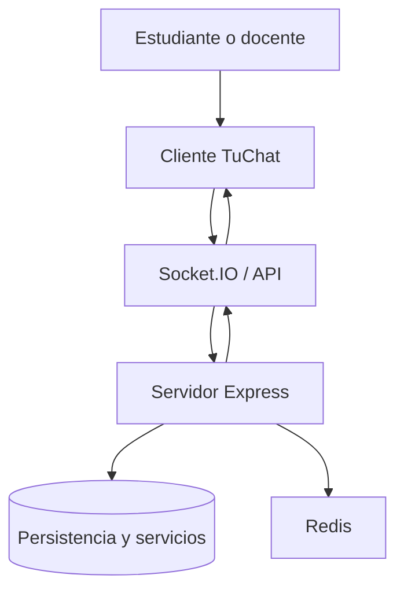
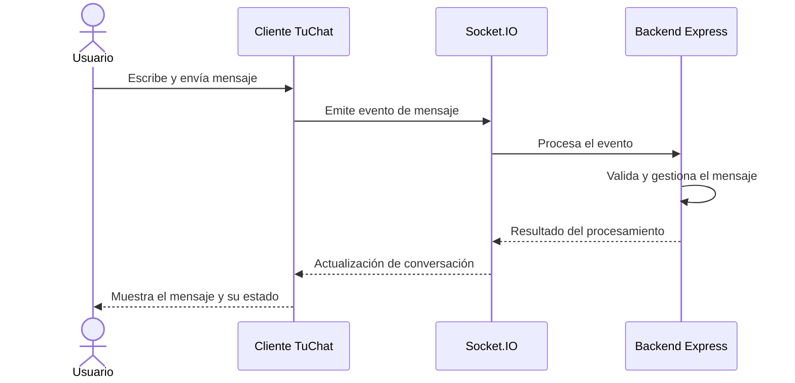
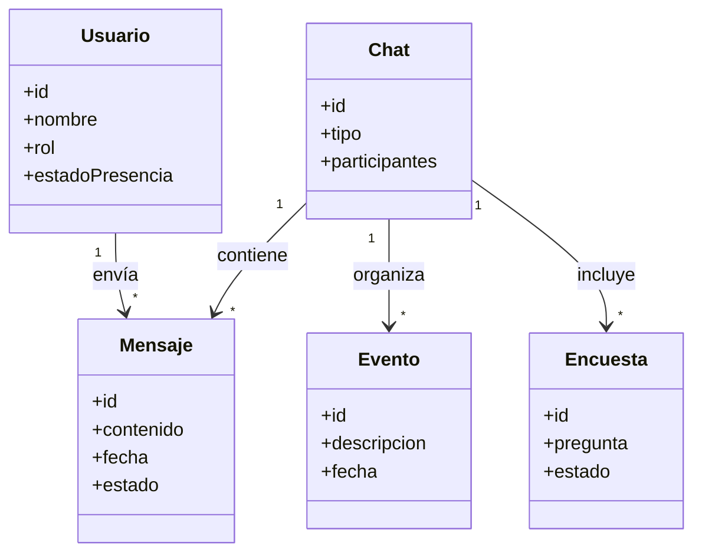
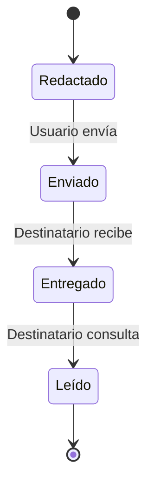
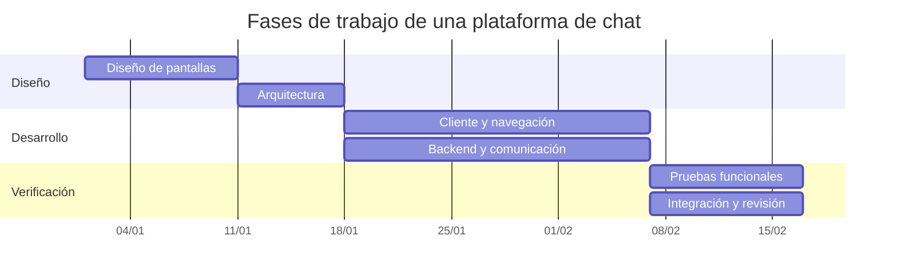
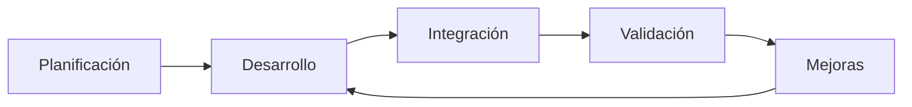

<!--
  README de TuChat-PL9
  Documentación académica y técnica del proyecto.
  Última revisión del contenido: noviembre de 2026.
-->

<a id="inicio"></a>
<div align="center">
  
  <h1>TuChat — Comunicación académica en tiempo real</h1>
  <p><strong>Una plataforma de comunicación para conectar a estudiantes, profesorado y centros educativos.</strong></p>
  <p>
    <a href="https://tu-chat-pl-9.vercel.app" title="Abrir la aplicación web">Aplicación web</a> ·
    <a href="https://github.com/GuayreEspinoMendez-PL9/TuChat-PL9" title="Consultar el código fuente">Repositorio</a>
  </p>
  <p>
    
    
    
  </p>
</div>

---

# Índice

1. [Presentación](#presentación)
2. [Tecnologías y arquitectura](#tecnologías-y-arquitectura)
3. [Funcionalidades](#funcionalidades)
4. [Instalación y ejecución](#instalación-y-ejecución)
5. [Modelos, fórmulas y diagramas](#modelos-fórmulas-y-diagramas)
6. [Pruebas y tareas](#pruebas-y-tareas)
7. [Recursos y referencias](#recursos-y-referencias)

---

# Presentación

[Volver al índice](#índice)

## ¿Qué es TuChat?

**TuChat** es una plataforma de comunicación académica diseñada para facilitar la coordinación entre los miembros de una comunidad educativa. Dispone de cliente web y móvil, junto con un backend que gestiona la comunicación en tiempo real.

El objetivo es reunir en un mismo entorno las conversaciones, los avisos docentes, los archivos y la información importante de cada grupo.

La aplicación está publicada en [tu-chat-pl-9.vercel.app](https://tu-chat-pl-9.vercel.app "Acceder a la versión web de TuChat").

### Objetivos principales

- Facilitar la comunicación entre profesorado y alumnado.
- Organizar las conversaciones por grupos académicos y chats privados.
- Dar visibilidad a anuncios, eventos, encuestas y mensajes importantes.
- Permitir el acceso desde distintos dispositivos.
- Mantener una experiencia adaptable a pantallas grandes y pequeñas.

> «La educación es el arma más poderosa que puedes usar para cambiar el mundo».  
> — Nelson Mandela

> [!NOTE]
> TuChat es un proyecto de comunicación académica. La disponibilidad de determinadas funciones puede depender de la plataforma, los permisos del dispositivo y la configuración del servidor.

### Una experiencia multiplataforma

<p align="center">
  
</p>

La interfaz está pensada para que una conversación pueda consultarse tanto desde un ordenador como desde un teléfono móvil.

- **En escritorio:** el listado de chats y la conversación pueden mostrarse en paralelo.
- **En móvil:** la conversación ocupa la pantalla para facilitar la lectura y la escritura.

[Volver al índice](#índice)

---

# Tecnologías y arquitectura

[Volver al índice](#índice)

## Stack tecnológico

| Capa | Tecnología | Función |
|:---|:---:|---|
| Cliente | Expo | Desarrollo y ejecución multiplataforma |
| Interfaz | React Native | Componentes de la aplicación |
| Navegación | Expo Router | Navegación entre pantallas |
| Backend | Express | API y lógica del servidor |
| Tiempo real | Socket.IO | Eventos y mensajes en directo |
| Llamadas | WebRTC | Audio, vídeo y pantalla compartida en web |
| Caché/soporte | Redis | Servicio auxiliar del backend |
| Contenedor | Docker | Entorno reproducible del servidor |

## Organización del repositorio

```text
TuChat-PL9/
├── server/                 # Backend Express y Socket.IO
│   ├── academico/          # Controladores académicos
│   ├── auth/               # Autenticación y autorización
│   ├── db/                 # Acceso a datos
│   ├── routes/             # Rutas de la API
│   └── services/           # Persistencia y servicios
├── tuchat/                 # Cliente Expo
│   ├── app/                # Rutas y pantallas
│   ├── assets/             # Imágenes y recursos
│   ├── components/         # Componentes reutilizables
│   └── src/                # Lógica, contextos y servicios
├── Dockerfile
├── docker-compose.yml
└── README.md
```

### Comunicación entre componentes

El cliente se comunica con el servidor para intercambiar información y eventos. Socket.IO permite actualizar las conversaciones sin tener que recargar la pantalla.



### Secuencia de envío de un mensaje



### Componentes conceptuales



> [!IMPORTANT]
> El diagrama de clases representa las entidades conceptuales principales del dominio de la aplicación; no pretende sustituir el esquema físico de la base de datos.

[Volver al índice](#índice)

---

# Funcionalidades

[Volver al índice](#índice)

## Mensajería y chats

- Conversaciones privadas y grupos académicos.
- Envío y recepción de mensajes en tiempo real.
- Estados de mensaje: **enviado**, **entregado** y **leído**.
- Respuestas, reacciones con emojis y copia de mensajes.
- Indicador de escritura y estado de presencia.
- Menciones a usuarios y roles: `@delegados`, `@profesor` y `@todos`.

## Herramientas académicas

| Herramienta | Uso | Ejemplo |
|:---|---|:---:|
| Anuncio oficial | Comunicar información docente | 📢 |
| Lectura obligatoria | Solicitar confirmación de lectura | 📖 |
| Material evaluable | Compartir material de evaluación | 📝 |
| Cambio urgente | Avisar de una modificación importante | ⚠️ |
| Encuesta | Recoger respuestas del grupo | 📊 |
| Evento | Comunicar fechas y actividades | 📅 |

### Búsqueda y organización

La búsqueda global permite localizar información por texto, archivos, personas, tipos de mensaje, hilos, fechas y otros elementos del chat.

También existe una bandeja de importantes que agrupa mensajes docentes destacados, eventos, encuestas y pines activos.

## Archivos y notificaciones

- Envío de imágenes, vídeos y documentos.
- Vista previa de imágenes y vídeos.
- Centro de archivos con filtros por tipo.
- Notificaciones de navegador y notificaciones push móviles.
- Navegación directa al chat o al contenido relacionado desde una notificación.

## Llamadas y personalización

La aplicación contempla llamadas de audio y vídeo mediante WebRTC, controles de cámara y micrófono y la opción de compartir pantalla en web.

Los temas disponibles incluyen `Light`, `Dark`, `System`, `Green`, `Red` y `Yellow`.

### Ciclo de vida de un mensaje



### Capturas y recursos visuales

La siguiente imagen es ilustrativa y no representa una captura exacta de la interfaz de TuChat.

<p align="center">
  
</p>

El logotipo local del proyecto se encuentra en [`tuchat/assets/images/logo.png`](tuchat/assets/images/logo.png "Logotipo incluido en el repositorio").

[Volver al índice](#índice)

---

# Instalación y ejecución

[Volver al índice](#índice)

## Requisitos previos

- Node.js 20 o una versión compatible con las dependencias del proyecto.
- npm.
- Docker y Docker Compose, si se desea iniciar Redis mediante el archivo incluido.
- Expo Go o un emulador/dispositivo compatible para probar la aplicación móvil.

## 1. Clonar el repositorio

```bash
git clone https://github.com/GuayreEspinoMendez-PL9/TuChat-PL9.git
cd TuChat-PL9
```

## 2. Iniciar el backend

Desde la carpeta `server/`:

```bash
cd server
npm install
npm run dev
```

Para iniciar el servidor en modo de ejecución normal:

```bash
npm start
```

## 3. Iniciar Redis (opcional)

Desde la raíz del repositorio:

```bash
docker compose up -d
```

El archivo `docker-compose.yml` configura Redis mediante la imagen `redis:7-alpine` y publica el servicio en el puerto `6379` de localhost.

## 4. Iniciar el cliente

Desde la raíz, entra en `tuchat/`:

```bash
cd tuchat
npm install
npm run start
```

También puedes utilizar los comandos específicos:

```bash
npm run web
npm run android
npm run ios
```

> [!WARNING]
> Las notificaciones push móviles necesitan un dispositivo físico para obtener el token de Expo. En web, el navegador debe conceder permiso para mostrar notificaciones. Comprueba también las variables de entorno y la configuración de servicios antes de desplegar el proyecto.

## Comandos disponibles

| Comando | Directorio | Descripción |
|:---|:---:|---|
| `npm run dev` | `server/` | Inicia el backend en desarrollo |
| `npm start` | `server/` | Inicia el backend |
| `npm run start` | `tuchat/` | Inicia Expo |
| `npm run web` | `tuchat/` | Ejecuta la versión web |
| `npm run android` | `tuchat/` | Ejecuta Android |
| `npm run ios` | `tuchat/` | Ejecuta iOS |

## Persistencia según plataforma

| Plataforma | Tecnología | Información local |
|:---|---|---:|
| Android / iOS | SQLite (`expo-sqlite`) | Mensajes, borradores y metadatos |
| Web | `localStorage` | Historial, borradores y preferencias |

[Volver al índice](#índice)

---

# Modelos, fórmulas y diagramas

[Volver al índice](#índice)

Esta sección utiliza expresiones matemáticas para describir métricas que pueden servir para analizar el comportamiento de un sistema de mensajería. Son **modelos ilustrativos**, no resultados de mediciones reales de TuChat.

## 1. Latencia de los mensajes

La latencia representa el tiempo transcurrido entre el envío y la recepción de un mensaje.

En línea: una latencia baja mejora la sensación de comunicación instantánea, es decir, \(L = t_{\text{recepción}} - t_{\text{envío}}\).

En bloque:

\[
L_{\text{media}} = \frac{1}{n}\sum_{i=1}^{n}
(t_{\text{recepción},i}-t_{\text{envío},i})
\]

Donde \(n\) es el número de mensajes analizados y \(L\) se expresa en milisegundos o segundos.

## 2. Porcentaje de entrega

Permite calcular qué proporción de mensajes enviados ha sido entregada correctamente.

\[
P_{\text{entrega}} =
\frac{M_{\text{entregados}}}{M_{\text{enviados}}}\times 100
\]

Por ejemplo, si se entregan 95 de 100 mensajes, el porcentaje de entrega es del 95 %.

## 3. Porcentaje de lectura

La lectura de mensajes puede analizarse mediante la proporción de mensajes leídos respecto a los entregados:

\[
P_{\text{lectura}} =
\frac{M_{\text{leídos}}}{M_{\text{entregados}}}\times 100
\]

Esta métrica es útil para estudiar la interacción con anuncios o comunicaciones docentes.

## 4. Capacidad de transmisión

El rendimiento de transferencia de datos puede expresarse como:

\[
R = \frac{D}{T}
\]

Donde \(D\) es la cantidad de datos transmitidos y \(T\) el tiempo empleado. El resultado puede expresarse en bytes/s o MB/s.

## 5. Disponibilidad del servicio

La disponibilidad mide qué proporción del tiempo total un servicio permanece operativo:

\[
A = \frac{T_{\text{operativo}}}
{T_{\text{total}}}\times 100
\]

Por ejemplo, una disponibilidad teórica del 99,9 % representa un tiempo de inactividad aproximado del 0,1 % del periodo considerado.

## 6. Tamaño de transferencia de archivos

Si un archivo de tamaño \(S\) se divide en bloques de tamaño \(B\), el número de bloques necesarios es:

\[
N_{\text{bloques}} = \left\lceil \frac{S}{B} \right\rceil
\]

Esta expresión ayuda a razonar sobre la transferencia de adjuntos grandes y la sincronización por bloques.

## Diagrama de planificación



[Volver al índice](#índice)

---

# Pruebas y tareas

[Volver al índice](#índice)

## Validación técnica

Para comprobar los tipos de TypeScript del cliente, ejecuta desde `tuchat/`:

```bash
npx tsc --noEmit
```

## Lista de pruebas manuales

- [ ] Iniciar sesión con un usuario institucional.
- [ ] Enviar y recibir mensajes entre dos usuarios.
- [ ] Comprobar los estados enviado, entregado y leído.
- [ ] Probar respuestas y reacciones con emojis.
- [ ] Crear un evento, una encuesta y un mensaje fijado.
- [ ] Probar menciones directas y por rol.
- [ ] Buscar mensajes por texto, fecha y archivo.
- [ ] Verificar notificaciones web y push móvil.
- [ ] Comprobar la sincronización móvil-web mediante QR.
- [ ] Cerrar y abrir la aplicación para revisar la persistencia local.

## Tareas de mantenimiento

1. Revisar incidencias y errores comunicados.
   - Comprobar los registros del servidor.
   - Reproducir el problema en web o móvil.
2. Mantener actualizadas las dependencias.
   - Revisar cambios incompatibles.
   - Ejecutar las pruebas después de actualizar.
3. Revisar la experiencia de usuario.
   - Comprobar la adaptación a distintos tamaños de pantalla.
   - Verificar accesibilidad y legibilidad.

## Estado de la aplicación



<div align="center">
  <strong>Mejorar, probar y volver a mejorar.</strong>
  <p><em>La calidad del software es un proceso continuo.</em></p>
</div>

[Volver al índice](#índice)

---

# Recursos y referencias

[Volver al índice](#índice)

## Documentación oficial

- [Expo](https://docs.expo.dev/ "Documentación oficial de Expo")
- [React Native](https://reactnative.dev/ "Documentación de React Native")
- [Expo Router](https://docs.expo.dev/router/introduction/ "Guía de navegación con Expo Router")
- [Express](https://expressjs.com/ "Documentación de Express")
- [Socket.IO](https://socket.io/docs/v4/ "Documentación de Socket.IO")
- [WebRTC](https://webrtc.org/ "Información y documentación de WebRTC")
- [Redis](https://redis.io/docs/ "Documentación de Redis")
- [Docker](https://docs.docker.com/ "Documentación de Docker")
- [GitHub del proyecto](https://github.com/GuayreEspinoMendez-PL9/TuChat-PL9 "Repositorio TuChat-PL9")

## Archivos del proyecto

- [`server/`](server/ "Código del backend")
- [`tuchat/`](tuchat/ "Código del cliente")
- [`Dockerfile`](Dockerfile "Configuración de la imagen del backend")
- [`docker-compose.yml`](docker-compose.yml "Servicios auxiliares de desarrollo")
- [`tuchat/assets/images/`](tuchat/assets/images/ "Recursos gráficos del cliente")

## Conceptos relacionados

> «La tecnología es solo una herramienta. En términos de conseguir que los niños trabajen juntos y motivarlos, el profesor es el más importante».  
> — Bill Gates

> «La innovación distingue a un líder de un seguidor».  
> — Steve Jobs

<!-- Comentario HTML/Markdown: este bloque no aparece en la vista renderizada.
     Se conserva como ejemplo de comentario dentro del README. -->

<div align="center">
  <hr>
  <p><strong>TuChat-PL9</strong> · Comunicación académica en tiempo real</p>
  <p><a href="#índice" title="Volver al índice principal">Volver arriba</a></p>
</div>
